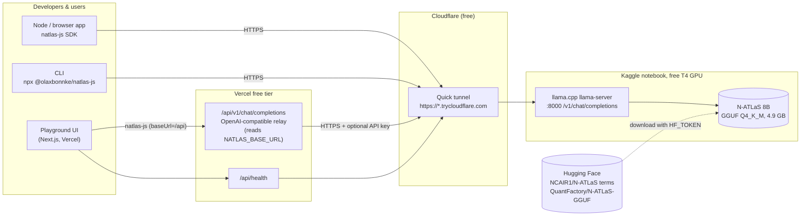

<div align="center">

# natlas-js

**Developer infrastructure for N-ATLaS, Nigeria's multilingual LLM.**
A zero-dependency TypeScript SDK, a web playground, and a $0 recipe to host the model on a free GPU.

Yorùbá · Hausa · Igbo · Nigerian English

`Nigeria AI Challenge (NAIC) · PS1 Developer Infrastructure` · MIT · by [Bonnke Olaitan](https://github.com/olaxbonnke)

</div>

---

## What it is

| Part | Path | What you get |
|---|---|---|
| **SDK** | [`packages/natlas`](packages/natlas) | `natlas-js` npm package: `chat()`, `chatStream()`, `translate()`, language helpers, typed errors, retries, CLI. ESM + CJS, zero runtime deps. |
| **Playground** | [`apps/playground`](apps/playground) | Next.js app (Vercel free tier): streaming chat, translation, language picker, Yoruba/Hausa/Igbo samples, live code snippets. |
| **Free server** | [`server`](server) | Kaggle/Colab notebook: llama.cpp + CUDA on a T4, OpenAI-compatible API, public HTTPS URL via a Cloudflare quick tunnel. |
| **Docs** | [`docs`](docs) | Technical documentation (Markdown + PDF): architecture, API reference, deployment, limitations, evaluation plan. |

## Why (PS1: Developer Infrastructure)

N-ATLaS is a national asset: an 8B Llama-3 model fine-tuned by Awarri for Nigerian languages. But the weights alone
are hard to build on: they are gated, 16 GB, need a GPU, and have no JavaScript tooling. Most Nigerian developers ship
web and mobile apps in JavaScript/TypeScript and cannot pay for GPU hosting.

natlas-js removes those barriers:

1. **One line to call N-ATLaS** from Node, the browser, React Native or edge functions, with streaming and good defaults
   (the model card's system prompt and repetition penalty).
2. **Translation that respects orthography**: prompt templates that ask for Yoruba tone marks and under-dots, Hausa
   hooked letters (ɓ ɗ ƙ ƴ) and Igbo dotted vowels (ị ọ ụ ṅ).
3. **$0 hosting** on a free Kaggle T4, so students, hackathon teams and civic-tech projects can start today.
4. **Production habits**: typed errors, timeouts, retries, a health probe and a friendly "model is waking up" state.

## Architecture



The tunnel URL changes every notebook session, so **every component reads it from one value**: `NATLAS_BASE_URL`.
Update it in Vercel and redeploy; no code changes.

## Quick start

### 1. Start N-ATLaS on a free GPU (about 12 minutes)

Follow [`server/README.md`](server/README.md): create Hugging Face and Kaggle accounts, accept the N-ATLaS terms, add
your `HF_TOKEN` as a Kaggle secret, enable **GPU T4** and **Internet**, then **Run All**. The notebook prints:

```
N-ATLaS is live at:   https://some-random-words.trycloudflare.com
```

### 2. Use the SDK

> **npm status:** natlas-js is not yet published to npm from this repo. Until it is, build it from source
> (`npm install && npm run build:sdk`) and import it from the workspace, or run the CLI with
> `node packages/natlas/dist/cli.js`.

```bash
npm install @olaxbonnke/natlas-js
export NATLAS_BASE_URL=https://some-random-words.trycloudflare.com
```

```ts
import { NAtlas } from "@olaxbonnke/natlas-js";

const natlas = new NAtlas(); // reads NATLAS_BASE_URL (and NATLAS_API_KEY if set)

// Yoruba conversation
const reply = await natlas.chat("Báwo ni o ṣe wà? Sọ ìtàn kúkúrú kan nípa Ìjàpá.", { replyIn: "yo" });
console.log(reply.content);

// Streaming in Hausa
for await (const chunk of natlas.chatStream("Menene amfanin noman rani ga manoma?", { replyIn: "ha" })) {
  process.stdout.write(chunk.delta);
}

// Translation, English → Igbo
const { text } = await natlas.translate("Education is the key to a better future.", { from: "en", to: "ig" });

// Multi-turn with your own system prompt
await natlas.chat([
  { role: "system", content: "You are a patient Yoruba tutor for beginners." },
  { role: "user", content: "Kí ni ìtumọ̀ 'Ẹ kú àárọ̀'?" },
]);

// Is the free GPU awake?
const health = await natlas.health(); // { status: "online" | "loading" | "offline" | "unauthorized", latencyMs }
```

CLI:

```bash
npx @olaxbonnke/natlas-js "Báwo ni?"
npx @olaxbonnke/natlas-js --translate --from en --to ha "Where is the market?"
npx @olaxbonnke/natlas-js --health
```

More in [`examples/`](examples) and the [SDK README](packages/natlas/README.md).

### 3. Run the playground

```bash
npm install
cp apps/playground/.env.example apps/playground/.env.local   # set NATLAS_BASE_URL
npm run dev                                                   # http://localhost:3000
```

**Deploy to Vercel (free):** import the GitHub repo, set **Root Directory** to `apps/playground` (Vercel detects the npm
workspace and installs from the root), add the env var `NATLAS_BASE_URL` (and `NATLAS_API_KEY` if you set one), deploy.
Each new Kaggle session: update `NATLAS_BASE_URL` → **Redeploy**.

No GPU handy while working on the UI? `node scripts/mock-natlas-server.mjs` starts a **fake, development-only**
endpoint on :8000 that returns canned `[mock]` text. It runs no model and must never back a public deployment.

## Every response comes from N-ATLaS

natlas-js, the playground and the server notebook use **only N-ATLaS**. There is no fallback to, and no call to, any
other foundation model or hosted AI API (no OpenAI, Gemini, Claude or similar). The relay route forwards requests
exclusively to the `NATLAS_BASE_URL` you configure, which the notebook points at the N-ATLaS GGUF; when that endpoint
is down, the playground says so instead of answering with something else. "OpenAI-compatible" refers only to the
HTTP request format that llama.cpp exposes.

## Model and attribution

- **N-ATLaS is an initiative of the Federal Ministry of Communications, Innovation and Digital Economy, and powered by
  Awarri Technologies.** Governance with the National Centre for Artificial Intelligence and Robotics (NCAIR) and NITDA.
- Official weights: [`NCAIR1/N-ATLaS`](https://huggingface.co/NCAIR1/N-ATLaS) (gated; accept the Terms of Use).
- Served file: [`QuantFactory/N-ATLaS-GGUF`](https://huggingface.co/QuantFactory/N-ATLaS-GGUF) →
  `N-ATLaS.Q4_K_M.gguf` (4.92 GB), a **community** llama.cpp quantization of NCAIR1/N-ATLaS, not an official release.
- The model is licensed under the **Terms of Use for N-ATLaS** (v1.0, Sept 2025): research, education, civic and
  community use; up to 1,000 active end-users per 30 days without a commercial licence; prohibited uses include
  surveillance, disinformation, fraud and military use. natlas-js's MIT licence covers this code only.

```bibtex
@misc{awagptv1_2025,
  title={N-ATLaS-LLM: A Multilingual African Language Model},
  author={Awarri Technologies and National Information Technology and Development Agency},
  year={2025}, publisher={Hugging Face}
}
```

## Repository layout

```
natlas-js/
├── packages/natlas/        # natlas-js SDK (src, tests, tsup build, CLI)
├── apps/playground/        # Next.js 15 + Tailwind playground (Vercel)
├── server/                 # Kaggle/Colab notebook (.ipynb + .py) and beginner guide
├── examples/               # runnable SDK examples + eval/ harness
├── docs/                   # TECHNICAL_DOCUMENTATION.md + PDF
└── scripts/                # mock server (dev only), notebook + PDF builders
```

## Development

```bash
npm install
npm test            # SDK unit tests (vitest, mocked fetch)
npm run build       # SDK (ESM+CJS+d.ts) then playground (next build)
npm run docs:pdf    # rebuild docs/natlas-js-technical-documentation.pdf
```

## Roadmap

- [ ] Publish `natlas-js` to npm with provenance; GitHub Actions CI
- [ ] Python twin (`natlas-py`) with the same API
- [ ] React hooks package (`useNAtlasChat`, `useTranslate`)
- [ ] N-ATLaS ASR models (speech-to-text for Yoruba, Hausa, Igbo, Nigerian English) behind the same SDK
- [ ] Tool calling / JSON mode once validated on N-ATLaS
- [ ] Published human evaluation by fluent speakers using `examples/eval`
- [ ] One-click persistent hosting options (Hugging Face Spaces GPU grants, university GPU partners)
- [ ] Response caching and a shared community endpoint with fair-use limits

## Licence

MIT © 2026 Bonnke Olaitan. See [LICENSE](LICENSE). Model weights: N-ATLaS Terms of Use.
