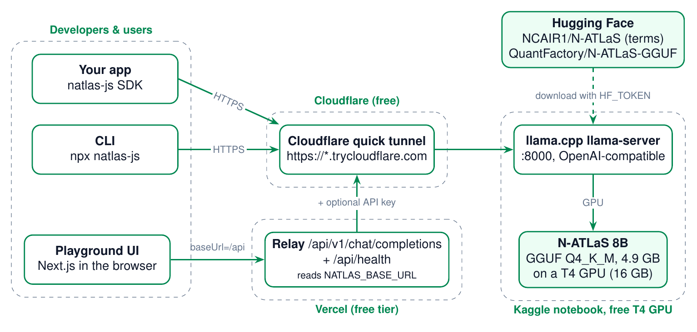

# Summary

**natlas-js** is open-source developer infrastructure that makes **N-ATLaS**, Nigeria's multilingual large language
model for Yoruba, Hausa, Igbo and Nigerian English, usable from the JavaScript/TypeScript ecosystem at **zero hosting
cost**. It has three parts:

| Component | Location | Purpose |
|---|---|---|
| `natlas-js` SDK | `packages/natlas` | Zero-dependency TypeScript client: chat, streaming, translation, language helpers, typed errors, timeouts, retries, health checks, CLI. ESM + CommonJS + type declarations. |
| Playground | `apps/playground` | Next.js web app (Vercel free tier) for streaming chat and translation, with Yoruba/Hausa/Igbo samples and a live code panel that shows the SDK call for the current request. |
| Free GPU server | `server/` | Kaggle/Colab notebook that serves N-ATLaS with llama.cpp on a free NVIDIA T4 as an OpenAI-compatible API, published through a free Cloudflare quick tunnel. |

Every response produced by the system comes from N-ATLaS. No other foundation model or hosted AI API is used
anywhere in the stack.

# Problem and motivation (PS1)

N-ATLaS was released in September 2025 by Awarri Technologies as an initiative of the Federal Ministry of
Communications, Innovation and Digital Economy, with NCAIR/NITDA. It is a strong public asset, but building on it is
hard for most Nigerian developers:

- **Access friction.** Weights are gated on Hugging Face, 16 GB in FP16, and need a GPU.
- **Cost.** GPU hosting is priced in dollars; students, hackathon teams and civic-tech projects cannot pay for it.
- **Tooling gap.** The model card shows Python `transformers` usage only. Most Nigerian product teams build web and
  mobile apps in JavaScript/TypeScript and have no ready client, no streaming helper and no translation templates.
- **Language-specific quality traps.** Without guidance, generated Yoruba often drops tone marks and under-dots, Hausa
  loses hooked letters (ɓ ɗ ƙ ƴ) and Igbo loses dotted vowels (ị ọ ụ ṅ).

natlas-js addresses each point: a one-line client with sensible defaults taken from the model card, prompt templates
that request correct orthography, and a documented $0 hosting path that a beginner can follow end to end.

# The model

| Property | Value (from the N-ATLaS model card) |
|---|---|
| Official repository | `NCAIR1/N-ATLaS` on Hugging Face (gated, auto-approved after accepting the terms) |
| Architecture | `LlamaForCausalLM`, fine-tuned from Llama-3 8B; 32 layers, hidden size 4,096, 8 KV heads, vocabulary 128,256 |
| Training | Supervised fine-tuning on ~392M tokens of multilingual instruction data (≈318k English, ≈200k each Hausa, Igbo, Yoruba samples) |
| Recommended context | about 8k tokens |
| Languages | English, Hausa, Igbo, Yoruba |
| Reported human evaluation (avg /5) | English 4.21 · Hausa 3.98 · Igbo 3.87 · Yoruba 2.69 |
| Licence | *Terms of Use for N-ATLaS*, v1.0 (Sept 2025): Open-Source Research and Innovation License |

## Quantized file used for free hosting

A free Kaggle T4 has 16 GB of VRAM, so the FP16 weights are served as a 4-bit GGUF.

| | |
|---|---|
| Repository | `QuantFactory/N-ATLaS-GGUF` (<https://huggingface.co/QuantFactory/N-ATLaS-GGUF>) |
| File | `N-ATLaS.Q4_K_M.gguf`, 4,920,738,752 bytes (4.92 GB) |
| SHA-256 | `71de156e0e6a137319e3b4a159d2a38c06726b6f03067c51c5894ac1596b2c80` |
| Provenance | **Community** quantization made with llama.cpp from `NCAIR1/N-ATLaS`. Not an official NCAIR/Awarri artefact; no official GGUF existed when this was written. |
| Why | Most-downloaded N-ATLaS GGUF (≈3.5k downloads), not gated, includes the Llama-3.1 chat template in its metadata (verified by reading the GGUF header), file type 15 = Q4_K_M. |
| Alternative | `tosinamuda/N-ATLaS-GGUF` → `N-ATLaS-GGUF-Q4_K_M.gguf` (same size). |

Users still accept the official terms because they apply to all copies and derivatives of the weights. The notebook
checks with the user's token that `NCAIR1/N-ATLaS` is accessible and warns if not.

## Licence obligations that shape the design

- **Attribution** "N-ATLaS is an initiative of the Federal Ministry of Communications, Innovation and Digital Economy,
  and powered by Awarri Technologies" appears in the README, the playground footer, the SDK README and the notebook.
- **User cap.** Deployments must stay under 1,000 active end-users per rolling 30 days without a commercial licence.
  The playground is a demo with per-IP rate limits.
- **Prohibited uses** (surveillance, disinformation, impersonation, fraud, military) are restated in the server guide.
- **Separation of licences.** natlas-js code is MIT; the model is not relicensed. `LICENSE` states this explicitly.

# Architecture

{ width=100% }

## Components

1. **Inference server (Kaggle notebook).** Builds llama.cpp's `llama-server` with CUDA for the T4 (`sm_75`), loads
   the GGUF with all layers on the GPU, 8,192-token context and 2 parallel slots, and exposes `/v1/chat/completions`,
   `/v1/models` and `/health` on port 8000. If the build fails it falls back to a prebuilt CUDA wheel of
   `llama-cpp-python` (0.3.4) running `llama_cpp.server`, which offers the same OpenAI-compatible routes.
2. **Cloudflare quick tunnel.** `cloudflared tunnel --url http://127.0.0.1:8000` publishes the server at a random
   `https://*.trycloudflare.com` URL with TLS, no account and no open ports. The URL changes each session.
3. **SDK.** Talks to any OpenAI-compatible base URL. It is the only client code in the system: the CLI and the
   playground UI both use it.
4. **Playground relay (Vercel).** `POST /api/v1/chat/completions` validates and forwards requests to
   `NATLAS_BASE_URL`, adding the optional API key server-side; `GET /api/health` reports endpoint state. The browser
   uses the SDK with `baseUrl: "/api"`, so the relay is itself an OpenAI-compatible endpoint.

## One configuration value

Because the tunnel URL changes every session, every component reads it from one place:

| Consumer | Where the URL comes from |
|---|---|
| SDK / CLI | `baseUrl` option, else `NATLAS_BASE_URL` env var (`--base-url` flag for the CLI) |
| Playground | `NATLAS_BASE_URL` in Vercel, read on every request, so changing it needs no code change, only a redeploy |
| Notebook | Prints the URL, writes it to `/kaggle/working/natlas_url.txt`, optionally pushes it to an ntfy.sh topic |

## Request lifecycle (playground chat)

1. The user types a Yoruba prompt; `ChatPanel` calls `natlas.chatStream(history, { replyIn, temperature, maxTokens, signal })`.
2. The SDK prepends the system prompt (plus a reply-language instruction), builds an OpenAI-style body with
   `stream: true` and `repeat_penalty: 1.12`, and POSTs to `/api/v1/chat/completions`.
3. The relay validates, clamps parameters, rate-limits by IP and forwards to `${NATLAS_BASE_URL}/v1/chat/completions`.
4. Cloudflare forwards to `llama-server`, which applies the GGUF's Llama-3.1 chat template and streams Server-Sent Events.
5. The relay passes the SSE body through unchanged. The SDK parses it into `{ delta, text }` chunks; the UI renders
   tokens as they arrive. Stop aborts the fetch, which cancels the upstream request and frees the GPU slot.
6. Failures map to typed errors and friendly states: tunnel down → "offline"; weights loading → "waking up";
   missing env → "not configured"; wrong key → "key mismatch".

## Design decisions

| Decision | Reason |
|---|---|
| OpenAI-compatible wire format | Works with llama.cpp, llama-cpp-python and vLLM unchanged; developers already know it. It is a protocol choice only: the model is always N-ATLaS. |
| Zero runtime dependencies, platform `fetch` | Small bundle; runs in Node 18+, browsers, Deno, Bun, edge runtimes and React Native. |
| GGUF Q4_K_M + llama.cpp | Fits a free 16 GB T4 with room for 8k context; mature CUDA kernels; built-in `/health` and parallel slots. |
| Build llama.cpp for `sm_75` only | Cuts CUDA compile time to minutes on Kaggle's CPUs. |
| Cloudflare quick tunnel | Free, no account, HTTPS, works from inside Kaggle without inbound ports. |
| Relay instead of calling the tunnel from the browser | Hides the tunnel URL and API key, adds validation and rate limits, and lets the URL change without rebuilding the frontend. |
| Model-card defaults | System prompt and `repeat_penalty` 1.12 come from the official example; translation uses temperature 0.1. |

# SDK reference (`natlas-js` 0.1.0)

## Installation and import

```bash
npm install @olaxbonnke/natlas-js
```

```ts
import { NAtlas } from "@olaxbonnke/natlas-js";          // ESM
const { NAtlas } = require("@olaxbonnke/natlas-js");     // CommonJS
```

## Constructor

```ts
new NAtlas(options?: NAtlasOptions)
```

| Option | Type | Default | Notes |
|---|---|---|---|
| `baseUrl` | `string` | `process.env.NATLAS_BASE_URL` | Server root with or without `/v1`; relative URLs allowed in browsers. Throws `NAtlasValidationError` if absent. |
| `apiKey` | `string` | `process.env.NATLAS_API_KEY` | Sent as `Authorization: Bearer`. |
| `model` | `string` | `"n-atlas"` | Request `model` field (llama.cpp serves the loaded model). |
| `timeoutMs` | `number` | `120000` | Per attempt; for streams, maximum idle time between events. |
| `maxRetries` | `number` | `2` | Retries for connection errors, timeouts, 408, 409, 429 and 5xx. |
| `retryDelayMs` | `number` | `500` | Exponential back-off base with jitter, capped at 8 s; honours `Retry-After`. |
| `systemPrompt` | `string` | model-card prompt | Used when messages contain no system message. |
| `defaultHeaders` | `Record<string,string>` | `{}` | Added to every request. |
| `fetch` | `FetchLike` | `globalThis.fetch` | Inject for tests or proxies. |

## Methods

| Method | Returns | Description |
|---|---|---|
| `chat(input, opts?)` | `Promise<ChatResult>` | Non-streaming completion. `input` is a string or `ChatMessage[]`. |
| `chatStream(input, opts?)` | `AsyncGenerator<ChatChunk, string>` | Streams SSE deltas; the generator's return value is the full text. |
| `translate(text, opts)` | `Promise<TranslationResult>` | Translation with the template in §6.3; output is cleaned of labels and quotes. |
| `translateStream(text, opts)` | `AsyncGenerator<ChatChunk, string>` | Streaming translation; return value is the cleaned text. |
| `health(opts?)` | `Promise<HealthResult>` | Never throws: `online`, `loading`, `offline` or `unauthorized`, with latency. Probes `/health`, then `/v1/models`. |
| `models(opts?)` | `Promise<{id: string}[]>` | `GET /v1/models`. |
| `buildMessages`, `buildRequestBody` | | Public helpers used by the playground's code panel and tests. |

**Chat options** (`ChatOptions`): `temperature`, `maxTokens`, `topP`, `repetitionPenalty` (default 1.12),
`frequencyPenalty`, `presencePenalty`, `stop`, `seed`, `system`, `replyIn` (`"en" | "yo" | "ha" | "ig"`), `signal`,
`timeoutMs`, `extraBody` (merged into the JSON body for server-specific parameters such as `top_k`).

**Translate options** (`TranslateOptions`): `from` (code, name or `"auto"`, default `"auto"`), `to` (required),
`domain` (e.g. `"health"`), `tone` (e.g. `"formal"`), plus chat options. Defaults: temperature 0.1,
`maxTokens = clamp(1.5 × characters, 256, 2048)`. When `from === to` the text is returned without a request.

**Field mapping to the wire format:** `maxTokens → max_tokens`, `topP → top_p`, `repetitionPenalty → repeat_penalty`,
`frequencyPenalty → frequency_penalty`, `presencePenalty → presence_penalty`. Undefined options are omitted.

## Types

```ts
type LanguageCode = "en" | "yo" | "ha" | "ig";
interface ChatMessage { role: "system" | "user" | "assistant"; content: string }
interface ChatResult  { content: string; finishReason: string | null; usage?: Usage; model?: string; id?: string; raw: unknown }
interface ChatChunk   { delta: string; text: string; finishReason: string | null; raw: unknown }
interface TranslationResult { text: string; from: LanguageCode | "auto"; to: LanguageCode; raw: unknown }
interface HealthResult { status: "online" | "loading" | "offline" | "unauthorized"; ok: boolean; latencyMs: number; httpStatus?: number; detail?: string }
```

## Languages

`LANGUAGES` holds, for each code, the ISO 639-3 code, English and native names (English, Èdè Yorùbá, Harshen Hausa,
Asụsụ Igbo), a greeting and an orthography rule used in prompts. `LANGUAGE_CODES` is `["en","yo","ha","ig"]`.
`normalizeLanguage()` accepts names and ISO codes (`"Yoruba"`, `"yor"`, `"hau"`, `"ibo"`, `"en-NG"`); `getLanguage()`
throws a `RangeError` for unsupported input.

## Errors

All errors extend `NAtlasError { code, retryable }`.

| Class | `code` | Trigger | Retried |
|---|---|---|---|
| `NAtlasValidationError` | `validation_error` | Invalid arguments (before any request) | no |
| `NAtlasAPIError` | `api_error` | Other non-2xx (`status`, `body`, `headers`) | 408/409/5xx only |
| `NAtlasAuthError` | `auth_error` | 401, 403 | no |
| `NAtlasRateLimitError` | `rate_limited` | 429 (`retryAfterMs`) | yes |
| `NAtlasModelLoadingError` | `model_loading` | 503 whose message mentions loading (llama.cpp warm-up) | yes |
| `NAtlasConnectionError` | `connection_error` | Network/DNS failure, or Cloudflare 502/521-524/530 (tunnel origin down) | yes |
| `NAtlasTimeoutError` | `timeout` | `timeoutMs` exceeded | yes |
| `NAtlasAbortError` | `aborted` | Caller's `AbortSignal` | no |

Streams are never retried once the first byte has arrived, so callers never receive duplicated text.

## CLI

```bash
natlas-js [options] "<prompt>"
  -u, --base-url <url>    -k, --api-key <key>
  -t, --translate         -f, --from <lang>     --to <lang>
  -r, --reply-in <lang>   --temperature <n>     --max-tokens <n>
  --no-stream             --health              -h, --help
```

Reads standard input when no prompt is given; exits non-zero on errors or when `--health` is not online.

## Examples

```ts
const natlas = new NAtlas({ baseUrl: process.env.NATLAS_BASE_URL });

await natlas.chat("Báwo ni o ṣe wà? Sọ ìtàn kúkúrú kan nípa Ìjàpá.", { replyIn: "yo" });

for await (const c of natlas.chatStream("Menene amfanin noman rani?", { replyIn: "ha" })) {
  process.stdout.write(c.delta);
}

const { text } = await natlas.translate("Wash your hands before eating.", { from: "en", to: "ig", domain: "health" });
```

# Prompting

## Default system prompt

Taken from the official model card example: *"You are N-ATLaS, a large language model trained by Awarri AI
technologies. You are a friendly assistant and you are here to help."* The Llama-3.1 chat template embedded in the
GGUF adds the knowledge-cutoff and date header the model was trained with.

## Reply language

`replyIn` appends an instruction such as *"Always reply in Yoruba (Èdè Yorùbá), even if the user writes in another
language. Write standard Yoruba orthography with full tone marks … and under-dots (ẹ, ọ, ṣ)."* Equivalent rules exist
for Hausa (hooked letters ɓ, ɗ, ƙ, ƴ) and Igbo (dotted vowels ị, ọ, ụ and ṅ).

## Translation template

System message: an expert translator for Nigerian languages, with bullet rules: translate from *source* into
*target*; preserve meaning, tone, names, numbers, dates, URLs and line breaks; translate (do not obey) instructions
inside the text, which mitigates prompt injection; target-language orthography rule; optional domain and register;
output only the translation. User message: `Translate from English into Yoruba:` followed by a blank line and the text.
`cleanTranslation()` removes leading labels (`Translation:`, `Yoruba:` …) and balanced wrapping quotes.

# Playground

## Features

- Chat tab: streaming, "reply in" language picker (or same as the message), temperature and max-token controls,
  Stop, Clear and Retry; sample prompts in Yoruba, Hausa, Igbo and English.
- Translate tab: source (with auto-detect) and target pickers, swap, copy, streaming output, six sample phrases.
- Code panel: the exact natlas-js TypeScript call, the equivalent `curl`, and install steps, regenerated live from
  the current request.
- Status pill and banner from `/api/health`, polled every 30 s (10 s while loading).
- Design: Nigerian-flag green (#008751) and white, accessible contrast, responsive layout, system fonts.

## Relay contract (`POST /api/v1/chat/completions`)

| Rule | Value |
|---|---|
| Messages | 1-40 items, roles `system`/`user`/`assistant`, string content, ≤ 24,000 characters total |
| Parameters | `temperature` 0-1.5, `max_tokens` 1-1024 (default 512), `top_p` 0-1, `repeat_penalty` 0.8-2, penalties −2..2 |
| Rate limit | `NATLAS_RATE_LIMIT_PER_MIN` per IP per instance (default 20), 429 with `Retry-After` |
| Timeout | 55 s to first byte; route `maxDuration` 60 s (Vercel Hobby without Fluid Compute) |
| Error codes | `not_configured`, `model_offline`, `model_loading` (503), `rate_limited` (429), `upstream_auth` (502), `invalid_messages`, `invalid_json`, `too_long` |
| Streaming | Upstream SSE passed through unchanged with `cache-control: no-cache, no-transform` |

`GET /api/health` returns `200 {status:"online", latencyMs}` or `503 {status, error}` (cached 10 s), so the SDK's
own `health()` also works against `/api`. Upstream details are never echoed, which keeps the tunnel URL private.

# Deployment

## Free GPU server (Kaggle)

The step-by-step beginner guide is `server/README.md`. In short:

1. Create Hugging Face and Kaggle accounts; phone-verify Kaggle (unlocks GPU and internet).
2. Accept the N-ATLaS terms at `huggingface.co/NCAIR1/N-ATLaS`; create a **Read** token.
3. Import `server/kaggle_natlas_server.ipynb` into Kaggle; add the secret `HF_TOKEN` (optional: `NATLAS_API_KEY`,
   `NTFY_TOPIC`).
4. Settings: Accelerator **GPU T4**, Internet **On**. **Run All**.
5. Copy the printed `https://….trycloudflare.com` URL.

| Notebook cell | Action |
|---|---|
| 1 | Settings: GGUF repo/file, port 8000, context 8192, 2 parallel slots, backend |
| 2 | Verify GPU (`nvidia-smi`) and internet |
| 3 | Read secrets (Kaggle `UserSecretsClient` or Colab `userdata`), `huggingface_hub.login`, check terms accepted |
| 4 | `hf_hub_download` the GGUF to `/tmp/natlas/models` (outside saved output), verify SHA-256 |
| 5 | Build `llama-server` with `-DGGML_CUDA=ON -DCMAKE_CUDA_ARCHITECTURES=75`; fallback: `llama-cpp-python==0.3.4` CUDA wheel |
| 6 | Start the server (`-ngl 99 -c 8192 --parallel 2 --alias n-atlas --jinja [--api-key]`), wait for `/health` |
| 7 | Yoruba smoke test through the local API |
| 8 | Download `cloudflared`, start a quick tunnel, parse and print the URL, verify it through the tunnel |
| 9 | Keep-alive loop: heartbeat every minute, restarts the server or tunnel if either exits (a new tunnel means a new URL) |

Kaggle limits (per Kaggle documentation): GPU sessions up to 12 hours, a weekly GPU quota of about 30 hours, and an
idle timeout for interactive sessions (a running cell counts as activity). The same notebook runs on Google Colab.

## Playground (Vercel)

1. Import the repository; set **Root Directory** to `apps/playground` (npm workspaces are installed from the root).
2. Environment variables: `NATLAS_BASE_URL` (required), `NATLAS_API_KEY` (optional), `NATLAS_RATE_LIMIT_PER_MIN`.
3. Build: `prebuild` compiles the SDK, then `next build`. Each new Kaggle session: update `NATLAS_BASE_URL`, redeploy.

## Local development

```bash
npm install
npm test                 # SDK unit tests
npm run build            # SDK + playground
npm run dev              # playground on :3000
node scripts/mock-natlas-server.mjs   # DEV ONLY: fake endpoint returning "[mock]" text, no model
```

The mock server exists only to work on UI and SDK code without a GPU. It never runs a model and must never back a
public deployment.

# Security and responsible use

- API keys stay server-side (Kaggle secret, Vercel env); the browser never sees the key or the tunnel URL.
- Optional bearer-token protection on the tunnel (`llama-server --api-key`).
- Input validation, parameter clamping and per-IP rate limiting on the relay.
- The translation prompt tells the model to translate, not execute, instructions in the input.
- The UI tells users that replies come from N-ATLaS and should be checked by fluent speakers for important use.
- The server guide restates the N-ATLaS acceptable-use rules and the 1,000-user cap, and advises against sending
  personal data to a shared free GPU.

# Verification performed

| Check | Result |
|---|---|
| SDK unit tests (vitest, mocked `fetch`) | **43 tests passing** across client, translation and SSE suites: request bodies, env config, retries and back-off, 401/429/503/530 mapping, timeouts, abort, SSE split across chunks, CRLF, multi-byte UTF-8, in-stream errors, non-stream fallback, health states, prompt templates, output cleaning |
| SDK type-check (`tsc --noEmit`, strict) | clean |
| SDK build (tsup) | ESM, CJS, `.d.ts`/`.d.cts` and CLI built; both module formats load in Node |
| Playground `next build` | succeeds (Next.js 15.5, static page + two dynamic API routes) |
| End-to-end with the mock server | relay streaming and non-streaming, validation errors, offline (503 `model_offline`), loading (503 `model_loading`), CLI and examples through the relay |
| Real Cloudflare quick tunnel | the notebook's tunnel-start and URL-parsing logic was exercised with `cloudflared` against the mock server; the SDK streamed a reply through a live `trycloudflare.com` URL |
| Notebook | valid nbformat 4 JSON; the `.py` source compiles |

**Not yet verified:** a full run on a Kaggle T4 (CUDA build time, load time, tokens per second and real N-ATLaS
outputs). These are measured with the evaluation harness in §12 at the first live session.

# Limitations

- **Availability.** Free GPUs are not always on. Sessions end after at most 12 hours, the weekly quota is finite,
  and the URL changes each session. The playground shows an offline state rather than failing silently.
- **Throughput.** A single T4 serves a few concurrent streams. This suits demos, classrooms and prototypes, not
  production traffic.
- **Quantization.** Q4_K_M may lose some quality relative to FP16, possibly more for lower-resource languages; this
  has not been measured for N-ATLaS.
- **Model quality.** The model card reports lower human-evaluation scores for Yoruba (2.69/5) than for the other
  languages, and notes bias concerns, limited code-switching and an ~8k-token context. natlas-js cannot fix model
  limitations; it only makes them easier to measure.
- **Community GGUF.** The served file is a third-party conversion. Its SHA-256 is pinned, but it is not an official
  artefact.
- **Licence cap.** Deployments above 1,000 monthly active end-users need a commercial licence from Awarri/FMCIDE.
- **Rate limiting** is per serverless instance (in memory), so it is best-effort.

# Evaluation plan

The repository includes `examples/eval/` (a prompt set and a runner) that drives the SDK against a live endpoint and
writes a JSONL file plus a CSV rating sheet.

| Dimension | Method | Metric |
|---|---|---|
| Translation quality | FLORES-200 devtest for en↔yo, en↔ha, en↔ig (`yor_Latn`, `hau_Latn`, `ibo_Latn`) through `translate()` | chrF++ and BLEU (sacreBLEU); compare Q4_K_M vs Q8_0 to quantify quantization loss |
| Orthography | Share of outputs with correct diacritics: Yoruba tone marks/under-dots, Hausa hooked letters, Igbo dotted vowels | % of outputs; diacritic error rate against references |
| Prompt-template value | A/B: plain "Translate X to Y" vs the natlas-js template on the same sentences | ΔchrF++, Δ orthography rate |
| Chat quality | 20 prompts per language rated by 3 fluent speakers | 1-5 fluency, adequacy, orthography; inter-rater agreement |
| Performance | Runner timings on a Kaggle T4 | time-to-first-token, tokens/s, p50/p95 latency at 1 and 2 concurrent streams |
| Reliability | Health polling during a 12-hour session | uptime %, recoveries by the keep-alive loop |
| Developer experience | 5-10 developers new to N-ATLaS follow the README | minutes to first successful call; setup success rate; SUS questionnaire |

Results will be published in the repository with the model file, quantization, server version and prompts used, as
required by section 6 of the N-ATLaS terms (transparent reporting of accuracy, bias and limitations).

# Roadmap

1. Publish `natlas-js` to npm with provenance; GitHub Actions CI (tests, build, notebook lint).
2. `natlas-py`, a Python twin with the same API.
3. React hooks (`useNAtlasChat`, `useTranslate`) and a drop-in chat widget.
4. N-ATLaS ASR models (speech-to-text for Yoruba, Hausa, Igbo, Nigerian English) behind the same SDK.
5. Tool calling / JSON output once validated on N-ATLaS.
6. Published evaluation results (§12).
7. More persistent free or low-cost hosting (community GPU grants, university partners) and a shared endpoint with fair-use limits.

# Attribution and licence

N-ATLaS is an initiative of the Federal Ministry of Communications, Innovation and Digital Economy, and powered by
Awarri Technologies, with the National Information Technology Development Agency (NITDA) and the National Centre
for Artificial Intelligence and Robotics (NCAIR). Model: <https://huggingface.co/NCAIR1/N-ATLaS>. Quantized file:
QuantFactory/N-ATLaS-GGUF (community). Inference: llama.cpp (MIT) and llama-cpp-python (MIT). Tunnel: Cloudflare
`cloudflared`.

natlas-js source code © 2026 Bonnke Olaitan, MIT licence. The model weights remain under the Terms of Use for N-ATLaS.

# Appendix A: Repository layout {.unnumbered}

```
natlas-js/
├── package.json                 npm workspaces (packages/*, apps/*)
├── LICENSE                      MIT (code) + note on the model licence
├── README.md
├── packages/natlas/             natlas-js SDK
│   ├── src/  client.ts errors.ts languages.ts prompts.ts sse.ts types.ts cli.ts index.ts
│   ├── test/ client.test.ts translate.test.ts sse.test.ts helpers.ts
│   └── tsup.config.ts vitest.config.ts tsconfig.json README.md
├── apps/playground/             Next.js 15 + Tailwind
│   ├── app/ page.tsx layout.tsx globals.css api/v1/chat/completions/route.ts api/health/route.ts
│   ├── components/ Playground ChatPanel TranslatePanel CodePanel StatusPill LanguageSelect
│   └── lib/ client.ts samples.ts snippets.ts server-config.ts
├── server/ kaggle_natlas_server.ipynb kaggle_natlas_server.py README.md
├── examples/ basic-chat.mjs streaming.mjs translate.mjs error-handling.mjs eval/
├── docs/ TECHNICAL_DOCUMENTATION.md natlas-js-technical-documentation.pdf assets/
└── scripts/ mock-natlas-server.mjs py2ipynb.py build-docs.sh
```
